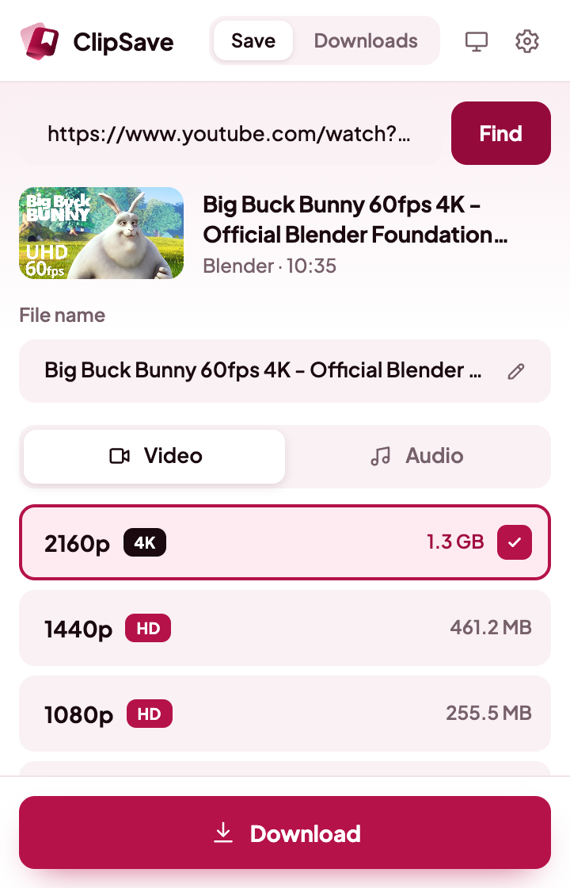
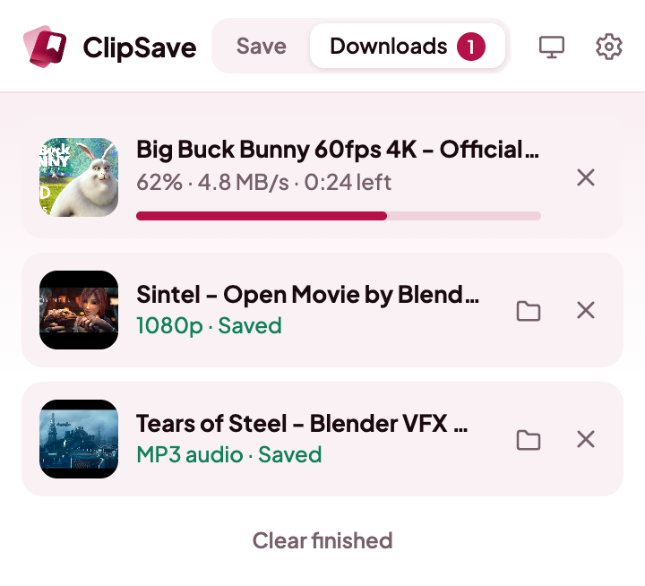
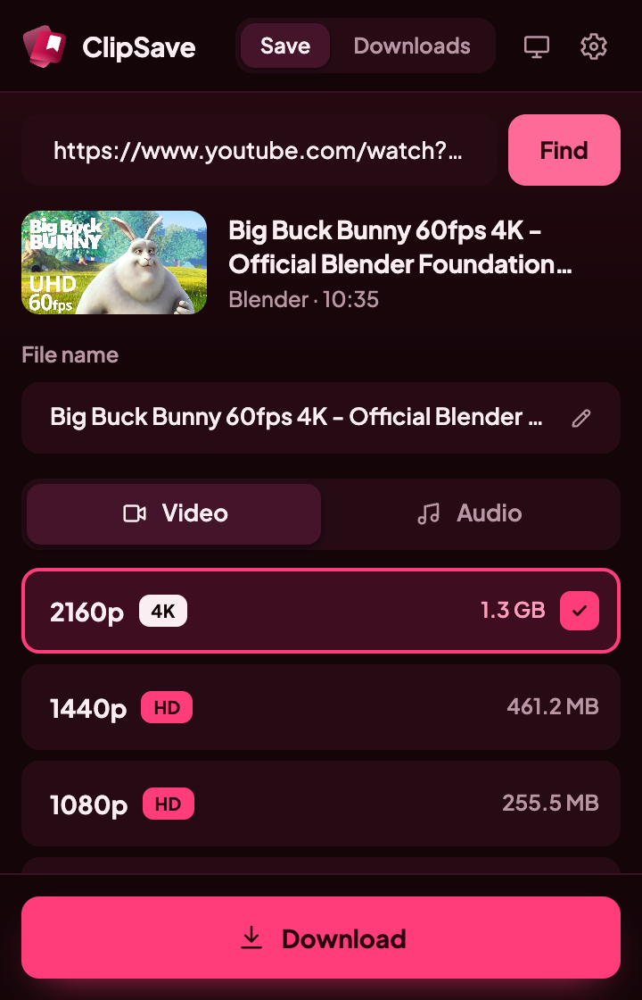
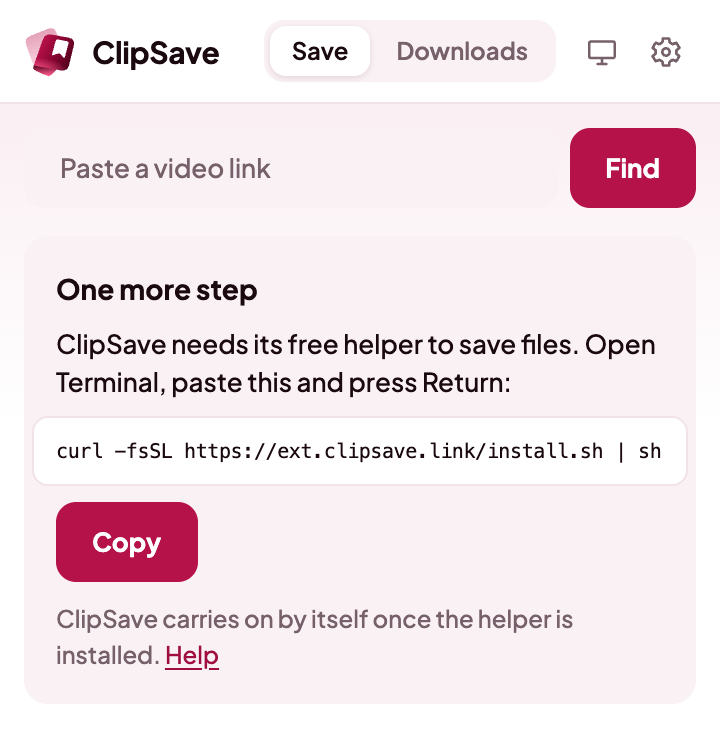
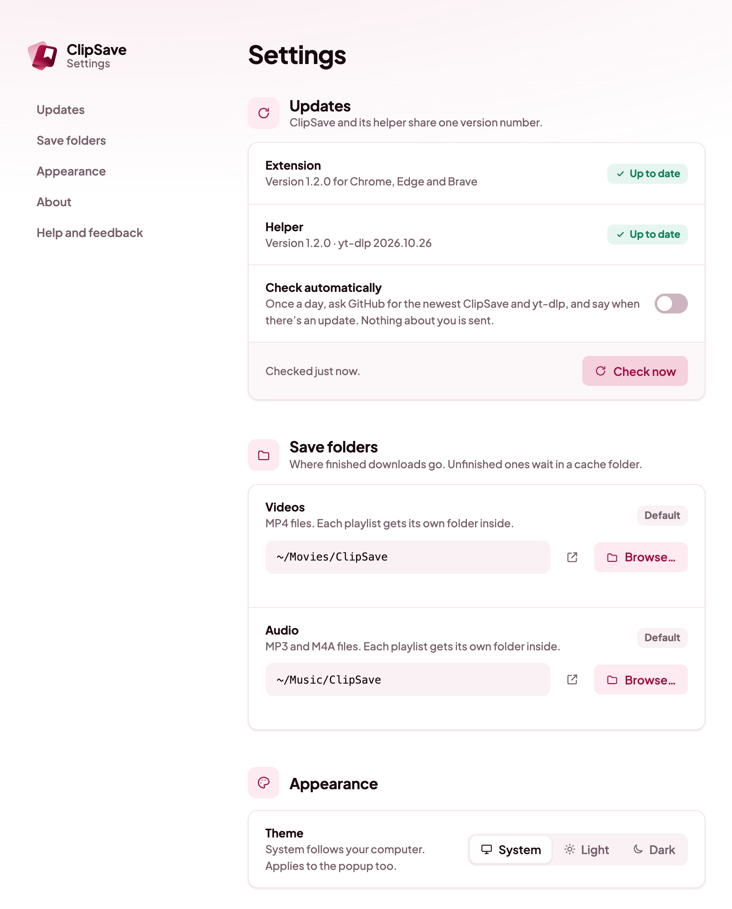

<p align="center">
  
</p>

<h1 align="center">ClipSave for browsers</h1>

<p align="center">
  Save videos and audio from 1000+ sites to your computer, right from Chrome or Firefox.<br>
  Free, open source and private. The desktop sibling of the <a href="https://clipsave.link">ClipSave Android app</a>.
</p>

<p align="center">
  <a href="https://github.com/sahedulislamrony/ClipSave-Extensions/actions/workflows/ci.yml"></a>
  <a href="https://github.com/sahedulislamrony/ClipSave-Extensions/releases/latest"></a>
  <a href="LICENSE"></a>
</p>

<p align="center">
  
  &nbsp;
  
</p>

## What it does

- **One click on a video page.** ClipSave reads the page and lists every quality, up to 4K, with its file size.
  Switch between Video and Audio, pick one, and click Download.
- **Video or audio.** Save MP4 video, or MP3 / M4A audio.
- **Name your files.** The file name starts as the video's title; change it before you save.
- **YouTube, in every browser.** Chrome, Edge, Brave and Firefox all save from YouTube.
- **Whole playlists.** Open a playlist, or a video that's part of one, pick a quality and which videos, and
  save them all. Each playlist gets its own folder, and its files can be numbered.
- **Right-click to save.** Right-click a page or link and choose **ClipSave → Save video** or **Save audio**.
- **Keeps working in the background.** Close the popup and the download carries on. Cancel or retry any time.
- **One-click updates.** Settings checks for a new ClipSave and yt-dlp, and updates both in one click.
- **Private.** No account, no analytics, no servers. Everything runs on your computer.
- **Light or dark**, or follows your system.

Files go to a **ClipSave** folder in your Videos (Movies on macOS) and Music folders, or wherever you choose in
Settings. Works on macOS, Windows and Linux.

<p align="center">
  
</p>

## Install

ClipSave has two parts: the browser extension, and a small **helper** app that does the downloading with
[yt-dlp](https://github.com/yt-dlp/yt-dlp). Browser extensions aren't allowed to run download tools, so the
helper does it for them. It brings everything it needs, so there's nothing else to install.

1. Add the extension to Chrome, Edge, Brave or Firefox.
2. Click its button. It shows one command with a **Copy** button.
3. Paste it into Terminal (macOS, Linux) or PowerShell (Windows). The popup carries on by itself once it's done.

```bash
curl -fsSL https://ext.clipsave.link/install.sh | sh
```

```powershell
irm https://ext.clipsave.link/install.ps1 | iex
```

The installer downloads about 110 MB (the helper, yt-dlp, ffmpeg and QuickJS), checks every file against the
release's SHA-256 checksums and installs for your user only, with no administrator password. On Chrome, Edge and
Brave it also keeps a copy of the extension in the helper's folder: load that folder once with **Load unpacked** and
Settings keeps it up to date.

The full guide, with every browser and troubleshooting, is in **[docs/install.md](docs/install.md)**.

<p align="center">
  
</p>

## Settings

Click the gear in the popup to open Settings in its own tab.

- **Updates.** See the extension's and the helper's versions, **Check now**, or turn on **Check automatically**
  (once a day, off until you turn it on). **Update ClipSave** installs the newest release in one click, and
  **Update yt-dlp** brings yt-dlp's newest release between ClipSave releases.
- **Save folders.** Pick separate folders for videos and audio, or **Use default** to go back.
- **Appearance.** System, Light or Dark, for the popup and Settings.
- **About.** Versions, browser, system and where the helper's tools are, with **Copy details** for bug reports.
- **Help and feedback.** The install guide, bug reports, feature requests, the privacy policy and release notes.

<p align="center">
  
</p>

## Browsers

| | Chrome, Edge, Brave | Firefox |
|---|---|---|
| YouTube videos and playlists | Supported | Supported |
| Other sites | Supported | Supported |

ClipSave isn't published on the Chrome Web Store, whose rules don't allow YouTube downloads. Install it
unpacked as described in the install guide. On Firefox, install it from Firefox Add-ons, which keeps it up to date.

## Documentation

| | |
|---|---|
| [Install and use](docs/install.md) | For everyone: installing, using, updating, removing, troubleshooting |
| [Development](docs/development.md) | Building, running and testing from source |
| [Architecture](docs/architecture.md) | How the extension and helper fit together, and the message protocol |
| [Branching and releasing](docs/releasing.md) | The `dev` → `main` flow, checks, and how releases are published |
| [Contributing](CONTRIBUTING.md) | How to propose a change |
| [Privacy](PRIVACY.md) · [Security](SECURITY.md) | What ClipSave does with your data, and how to report a vulnerability |

## Please save responsibly

ClipSave is a tool for saving videos you have the right to keep: your own uploads, public-domain and
Creative Commons works, or videos a site lets you download. Respect copyright and each site's terms.

## License

[GPL-3.0-or-later](LICENSE). Third-party components and their licenses are listed in
[THIRD_PARTY_NOTICES.md](THIRD_PARTY_NOTICES.md).
